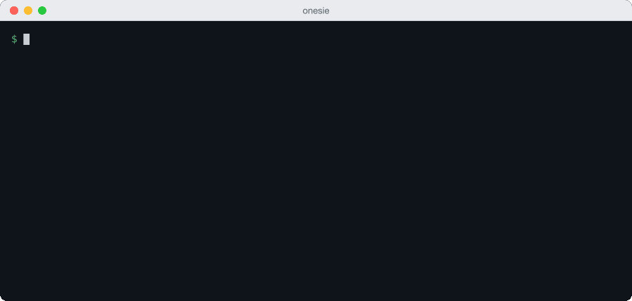

# onesie

[](https://github.com/frodi-karlsson/onesie/actions/workflows/ci.yml)
[](https://github.com/frodi-karlsson/onesie/releases)
[](LICENSE)
[](https://pkg.go.dev/github.com/frodi-karlsson/onesie)

Gate scripts and CI on fast, calibrated System One judgments: a score, a choice or an exit code.



Route a support ticket by naming the teams that can handle it.

```sh
echo 'I was charged twice for my order' | onesie 'who should handle this' --pick billing,shipping,technical -o raw
# billing
```

Run the same decision over a CSV export saved as `tickets.csv`. `--merge` keeps the input columns and adds the
chosen team. The error column is empty when the row succeeds.

```csv
id,body
1,I was charged twice for my order
```

```sh
onesie --ask team='who should handle this' --pick billing,shipping,technical \
    -i csv --map .body -o csv --merge < tickets.csv
```

```csv
id,body,team,error
1,I was charged twice for my order,billing,
```

## Thresholds from evidence

The built in `shell-safety` gate passes, blocks or asks a person to review a command. Its thresholds are
chosen from [40 labelled commands and their saved answers](examples/README.md#shell-safety).

```sh
onesie -f shell-safety -q --state 'git status'
# exit 0: pass
onesie -f shell-safety -q --state 'rm -rf ~'
# exit 1: fail, so block
onesie -f shell-safety -q --state 'echo hello > notes.txt'
# exit 7: unsure, so hand off to a person
```

For destroys, shell-safety blocks at 0.5 and passes below 0.25. The overwrite command scored 0.37,
so it goes to a person. Use your own labelled commands to choose thresholds for your gate. [Reproduce the check offline](examples/README.md#offline) without a key.

## Install

Homebrew, on macOS or Linux:

```sh
brew install frodi-karlsson/tap/onesie
```

The install script checks the download against the release checksums, and its build provenance
when `gh` is logged in:

```sh
curl -fsSL https://raw.githubusercontent.com/frodi-karlsson/onesie/main/install.sh | sh
```

The script installs to `~/.local/bin`. Set `ONESIE_INSTALL_DIR` for another directory, or
`ONESIE_VERSION` for a release other than the latest, such as `0.14.0`.

With Go:

```sh
go install github.com/frodi-karlsson/onesie/cmd/onesie@latest
```

Then store a key in a profile with `onesie profile create work --provider typesafe`, which prompts
for it and keeps it in the OS keychain.

In GitHub Actions, [`setup-onesie`](https://github.com/frodi-karlsson/setup-onesie) installs it with
the same checksum and provenance checks, and the key comes from a secret instead of a profile:

```yaml
- uses: frodi-karlsson/setup-onesie@v1
```

In Claude Code, the plugin can come first and walk you through the rest:

```
/plugin marketplace add frodi-karlsson/onesie
/plugin install onesie@onesie
```

### Uninstall

While the binary is still installed, run `onesie profile list`, then `onesie profile delete NAME`
for each profile, which also removes its key from the OS keychain. Then remove:

1. The binary, from `~/.local/bin` or `$ONESIE_INSTALL_DIR`.
2. The config dir, which also holds saved question files: `$ONESIE_CONFIG_DIR` if set, else
   `$XDG_CONFIG_HOME/onesie`, else `%APPDATA%\onesie` on Windows and `~/.config/onesie` elsewhere.
3. The cache dir: `$ONESIE_CACHE_DIR` if set, else `$XDG_CACHE_HOME/onesie`, else
   `~/Library/Caches/onesie` on macOS, `%LOCALAPPDATA%\onesie` on Windows and `~/.cache/onesie` on Linux.

## More decisions

`--ask` names several questions in one request. `--rate` chooses a level on an ordered scale.
`-f` loads saved questions, and `onesie questions` lists the four calibrated starter sets.
[Worked recipes](examples/README.md#recipes) cover streams, resumable batches, pull request
comments, ranking and local servers. [Mock answers](examples/README.md#testing-a-gate) exercise a
script without calling a model.

onesie supports TypeSafe, OpenRouter, Berget, Levanto and Cloudflare. Profiles hold provider
settings and keys. `--cache` reuses answers, `--print-request` previews requests without a key,
and experimental `--image` and `--box` questions work with images.

## Help and settings

`onesie --help` shows common tasks. Use `onesie help decisions` for gates, `onesie help exit-codes`
for exit codes, `onesie help input` for streams, and `onesie help all` for the full flag reference.
`onesie help calibrate all` covers calibration.

Look up [configuration precedence, profile fields, environment variables and question file keys](REFERENCE.md).

## Contributing

See [CONTRIBUTING.md](CONTRIBUTING.md).

## License

MIT. See [LICENSE](LICENSE).
